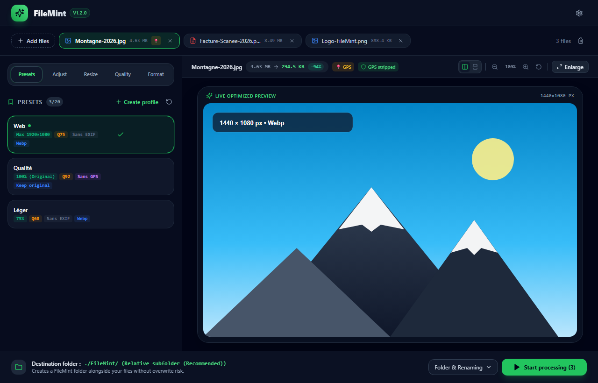
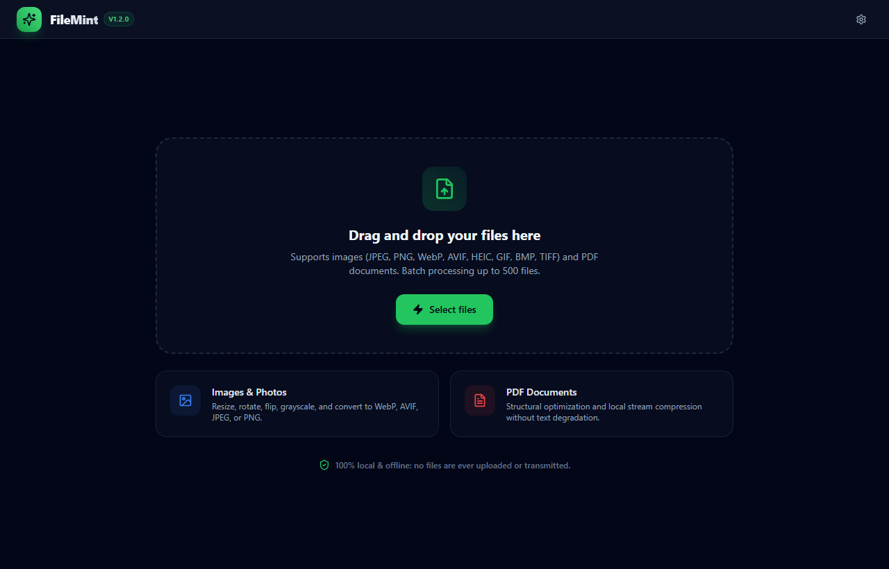
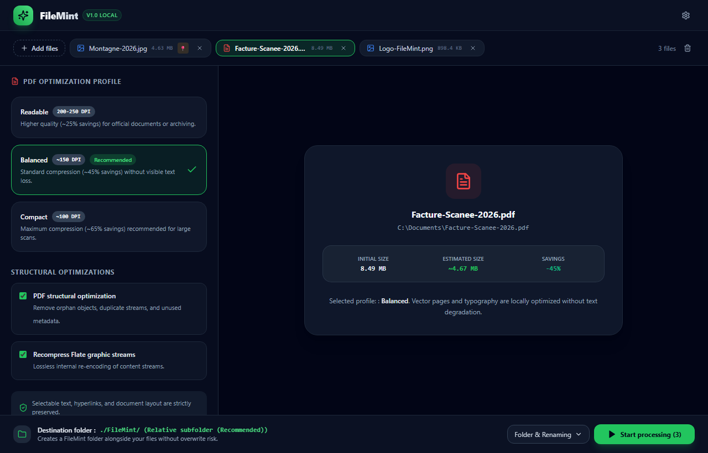
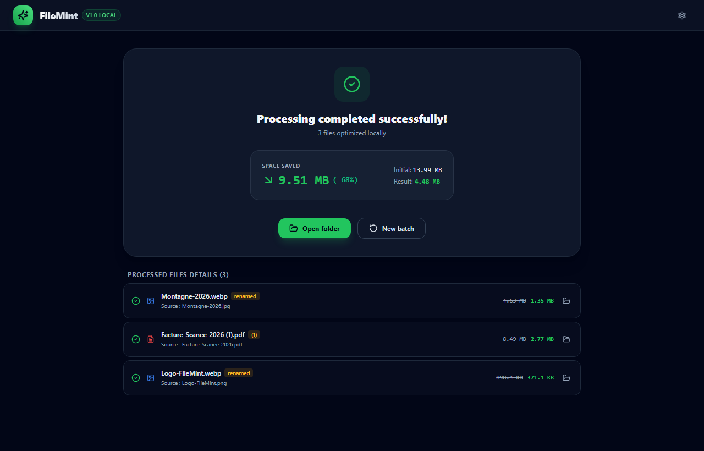

# FileMint 🍃

<p align="center">
  
</p>

<p align="center">
  <strong>Fast, local, privacy-first desktop converter and batch optimizer.</strong><br>
  <em>100% Offline • AI Vibe-Coded • Zero Telemetry • Native Rust Engine • Windows, macOS & Linux</em>
</p>

<p align="center">
  <a href="README.md"></a>
  <a href="README.fr.md"></a>
</p>

<p align="center">
  <a href="https://github.com/duboiss/FileMint/releases"></a>
  <a href="https://github.com/duboiss/FileMint/actions/workflows/ci.yml"></a>
  <a href="https://github.com/duboiss/FileMint/actions/workflows/codeql.yml"></a>
  
  <a href="LICENSE"></a>
  <a href="https://tauri.app/"></a>
  <a href="https://www.rust-lang.org/"></a>
</p>

<p align="center">
  
</p>

> [!NOTE]
> **✨ AI Vibe-Coded Project** — FileMint was designed and **vibe-coded with AI** (Google DeepMind Antigravity). All native Rust engines, React & Tailwind UI, and system integrations were developed through pair programming with the AI.

---

## 🌟 Core Principles

- **🔒 100% Local & Private:** No cloud, no account, zero telemetry. Files never leave your machine.
- **⚡ Native Rust Engine:** Multi-threaded image & PDF optimization (`image`, `oxipng`, `lopdf`, `rayon`).
- **🛡️ Non-Destructive:** Source files are untouched; outputs go to dedicated subfolders with collision detection.
- **👁️ Live Visual Diff:** Real-time side-by-side comparison slider with in-memory savings calculation.
- **🪟 Deep OS Integration:** Windows context menu (modern & classic), watch folders, macOS & Linux support.

---

## 📸 Interface Overview

| Drag & Drop Home | PDF Compression Profiles | Batch Results & Savings |
|:---:|:---:|:---:|
|  |  |  |

---

## 🚀 Key Features

### 🖼️ Image Optimization & Conversion
- **Smart Sizing & Effects:** Pixel dimensions, percentages, max bounds, rotation (90°/180°/270°), flips, and color effects (Grayscale, Sepia, Invert, Pure B&W thresholding).
- **Target Size Mode (Max KB/MB):** Set a strict file ceiling (200 KB, 500 KB, 1 MB, 2 MB, 5 MB, or custom). FileMint automatically determines optimal quality and Lanczos downscaling via binary search.
- **Quality & Lossless:** Continuous slider (10–100), quick presets (Light, Balanced, Max), lossless PNG/WebP, or bypass compression toggle for bit-exact conversions.
- **Privacy Sanitization:** Selective GPS stripping (keeps camera settings) or complete EXIF scrub.
- **Formats:** JPEG, PNG (with alpha), WebP, AVIF, BMP, GIF, and TIFF.

### 📄 PDF Document Compression
- **3 Compression Profiles:** *Readable* (~200–250 DPI), *Balanced* (~150 DPI), and *Compact* (~100 DPI).
- **Target Size Optimization:** Fit PDFs under upload thresholds for government or career portals.
- **Structural Optimization:** FlateDecode recompression and object cleanup without altering selectable text or links.

### 📂 Automatic Watch Folders
- **Multi-Folder Background Monitoring:** Configure unlimited watched folders running concurrently in the background.
- **Per-Folder Profiles & Destinations:** Assign dedicated optimization profiles (Web, Quality, Light, or custom presets) and custom destination folders to each watched folder.
- **Drop Box Mode:** Optionally delete source files upon success (ideal for temporary drop boxes).
- **Per-Rule Control & Status:** Name, toggle, or delete rules individually, with live counter and animated pulse in the app header (`Watching active (2)`).

### 📊 Lifetime Storage Stats & Renaming
- **Lifetime Impact:** Tracks cumulative disk space saved and total files optimized (100% local, reset anytime).
- **Context-Aware Dynamic Masks:** Rename batches with `{name}`, `{profile}`, `{width}`, `{quality}`, `{date}`, `{index}`.
- **Flexible Destinations:** Subfolder (default), same directory with `(1)` collision handling, or custom path.

---

## 💻 Download & Installation

Visit [**GitHub Releases**](https://github.com/duboiss/FileMint/releases) to download the latest installer:

| Operating System | Available Formats |
|---|---|
| **Windows** (10 / 11) | NSIS Installer (`.exe`) & MSI Package (`.msi`) |
| **macOS** (Apple Silicon & Intel) | Disk Image (`.dmg`) |
| **Linux** (Debian, Ubuntu, etc.) | `.deb` package & standalone `.AppImage` |

> [!TIP]
> **Windows SmartScreen Notice:** As open-source software without an expensive enterprise certificate, Windows may show a standard SmartScreen prompt on first run. Click **"More info"** then **"Run anyway"**.

---

## 🛠️ Development & Building

```bash
# Clone and install
git clone https://github.com/duboiss/FileMint.git && cd FileMint
npm install

# Start development (Hot Reload)
npm run tauri dev

# Build production binaries
npm run tauri build
```

---

## ⚖️ License

Licensed under the open-source [**MIT License**](LICENSE). Copyright (c) 2026 Steven DUBOIS and FileMint contributors.
